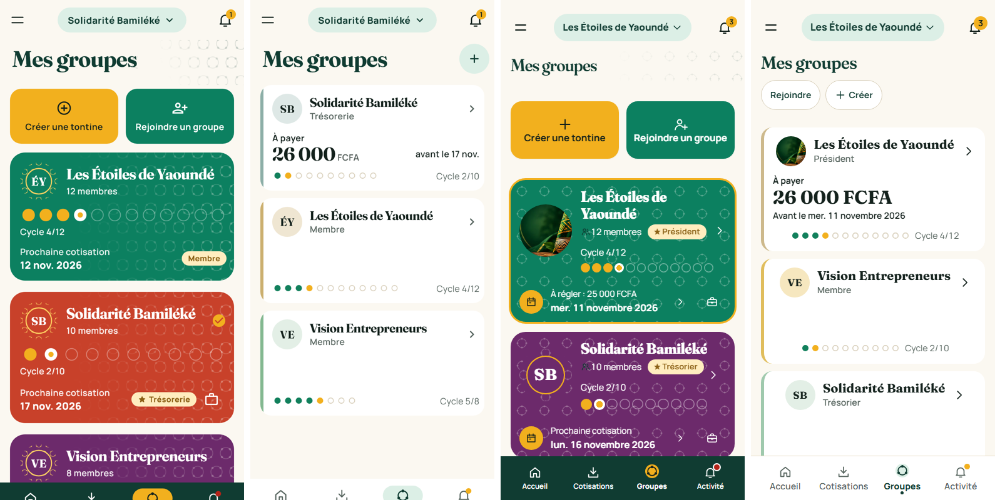

# Version calme — contrôles

De gauche à droite : mobile avant, mobile après, PWA avant, PWA après.

| Contrôle | Résultat |
|---|---|
| Teintes saturées par écran | 1 à 2 ; 3 sur l'accueil bureau à cause de la photo du groupe de test |
| Flou en niveaux de gris | le montant « À payer » ressort, carte en tête de liste |
| Audit PWA, 23 écrans, 7 largeurs | 0 texte sous 14 px, 0 contraste sous 4,5:1, 0 cible sous 44 px, 0 aplat vert sombre |
| Débordements mobile, 32 écrans, 3 largeurs | 0 |
| Connexion PWA | 0 pixel de différence |

Limite : l'audit de contraste ignore les textes sur dégradé ou image, et le seuil automatique des cibles est de 44 px ; les règles visent 48 px.
